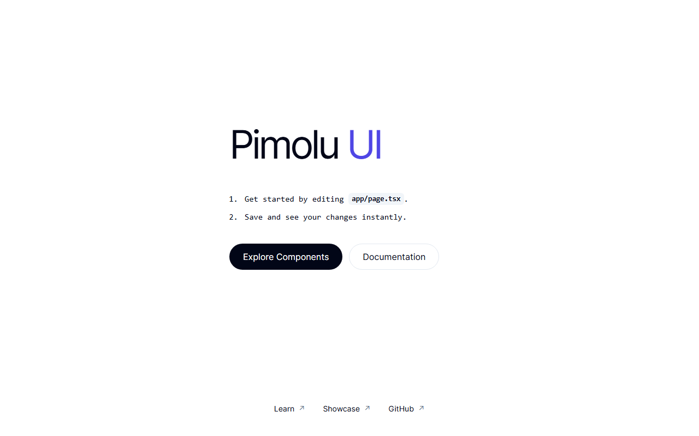

# Pimolu UI: Next.js Starter

A minimal Next.js 16 starter built with the published [Pimolu UI](https://pimolu.com) packages, TypeScript, Tailwind CSS, and the App Router.



> Pimolu UI is currently in **beta**. This starter pins `@pimolu/react` and `@pimolu/web-styles` to `0.1.0-beta.3.1`. Do not bump those versions without re-checking the component APIs and styles.

## Requirements

- Node.js **22.12+** (or 24+); the exact baseline is in `.nvmrc`
- npm **10+**. This repository is locked with `package-lock.json`, so use npm rather than yarn/pnpm/bun.

## Getting started

```sh
npm install
npm run dev
```

Open [http://localhost:3000](http://localhost:3000). Edit `app/page.tsx`; the page updates on save.

## Scripts

| Command             | Description                                              |
| ------------------- | -------------------------------------------------------- |
| `npm run dev`       | Start the development server (Turbopack)                 |
| `npm run lint`      | Run ESLint with the flat config                          |
| `npm run typecheck` | Generate Next.js route types, then run `tsc --noEmit`    |
| `npm run build`     | Create a production build                                |
| `npm run start`     | Serve the production build                               |

No test runner or CI/CD pipeline is configured. Lint, typecheck, and build are the local checks for this starter.

### Why `next typegen` before `tsc`?

Next.js 16 generates `PageProps`, `LayoutProps`, and `RouteContext` into `.next/types`. `next-env.d.ts` is gitignored, so a bare `tsc --noEmit` fails on a clean checkout. `npm run typecheck` handles the generation step for you.

## Pimolu UI setup

- `app/layout.tsx` imports `@pimolu/web-styles/styles.css` **before** `app/globals.css`, then wraps the app in `<PimoluProvider defaultTheme="system">`.
- Import components from `@pimolu/react`:

```tsx
import { Button } from "@pimolu/react";

export function Example() {
  return <Button appearance="outline">Hello Pimolu</Button>;
}
```

- Pimolu components are client components. A page that passes event handlers must be a client component (as `app/page.tsx` is).
- The starter page uses Pimolu layout and UI components (`Box`, `VStack`, `HStack`, `Heading`, `Text`, `Code`, `Button`, `Link`). Page-level layout CSS lives in `app/globals.css`.
- Tailwind v4 is compiled by the `@tailwindcss/turbopack` loader configured in `next.config.ts`; there is no PostCSS config or `tailwind.config.*`.
- The provider follows the system light/dark preference by default. Pass `defaultTheme="light"` or `defaultTheme="dark"` to change the starting theme, and `defaultStylePreset` for a Pimolu preset.

### Pimolu resources

- [Components](https://pimolu.com/components)
- [Documentation](https://pimolu.com/docs)
- [Showcase](https://pimolu.com/showcase)
- [Pimolu UI on GitHub](https://github.com/pimoludev/ui)

## Next.js 16 notes

- `cacheComponents` and `partialPrefetching` are enabled in `next.config.ts`. Data is dynamic by default; cache with `"use cache"` and wrap uncached async reads in `<Suspense>`.
- Cache Components requires the Node.js runtime. Do not add `export const runtime`.
- Version-matched Next.js documentation is bundled at `node_modules/next/dist/docs/`. Read it before using unfamiliar routing, caching, or metadata APIs.
- `AGENTS.md` contains repo-specific guidance for coding agents. Its top block is managed by `next dev`; keep it in the file.

## Project structure

```text
app/
  globals.css    Tailwind entry and starter page styles
  layout.tsx     Pimolu provider, global CSS imports, metadata
  page.tsx       Starter page built with Pimolu components
AGENTS.md
next.config.ts
```

## Deployment

The app has no environment variables or external services. Build with `npm run build`, then serve with `npm run start`, or deploy to a Node.js host such as Vercel. The route is currently statically prerendered.

## Tests

There is no test suite yet. If you add application logic, add a runner (for example Vitest for units or Playwright for flows). The starter itself is intentionally limited to the UI shell.

## License

[MIT](./LICENSE) © 2026 Pimolu
